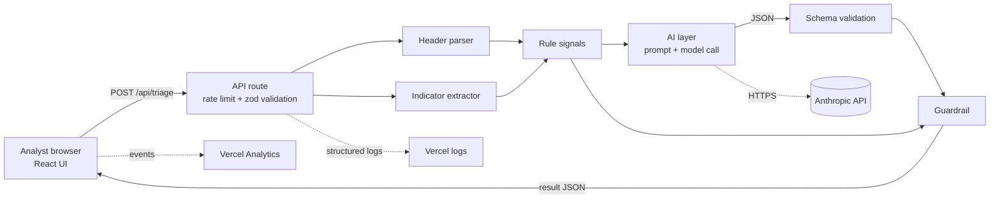

# Architecture Notes

## Overview

A single Next.js application on Vercel. The browser sends the pasted email to one server-side API
route. The route validates the input, runs deterministic checks, calls the language model, applies a
guardrail, and returns one JSON result. No database.

## Components

| Layer | File(s) | Responsibility |
|---|---|---|
| UI | `app/page.tsx`, `components/TriageApp.tsx`, `components/ResultCard.tsx` | Input box, sample emails, result display, copy buttons |
| API | `app/api/triage/route.ts` | Rate limit, size limit, validation, orchestration, logging |
| Parsing | `lib/headers.ts` | From / Reply-To / Return-Path / Subject, SPF / DKIM / DMARC |
| Extraction | `lib/ioc.ts` | URLs, domains, IPs, emails, hashes; defanging |
| Rules | `lib/signals.ts` | 20 red-flag checks with severity; guardrail; rules-only verdict |
| AI | `lib/ai.ts` | Provider config from env, system prompt, user prompt, model call |
| Contracts | `lib/schema.ts` | zod schemas for the request and the model reply |
| Pipeline | `lib/triage.ts` | Runs the steps in order and builds the result |
| Output | `lib/report.ts` | Ticket-ready text note |

## Data flow

1. The analyst pastes an email and clicks **Analyse email**.
2. The API route checks the rate limit (10 requests / minute / IP) and validates the body (20-20,000 characters).
3. Headers are parsed and indicators are extracted by code.
4. Rule checks produce a list of findings with severity.
5. The email, header summary and findings go to the model. The email is wrapped in an `<email>` block and treated as data.
6. The model reply must be JSON that matches the schema. If not, one retry; if it still fails, the app falls back to a rules-only verdict.
7. The guardrail compares the model verdict with the rule findings and raises it if needed. It never lowers it.
8. The result is returned with defanged indicators. Nothing is stored.

## Key design decisions

| Decision | Why |
|---|---|
| Rules **and** a model, not a model alone | Rules give verifiable evidence and protect against a model that is wrong or manipulated. The model adds judgement on wording and pretext that rules cannot capture. |
| Indicators extracted by code | Removes the risk of the model inventing or missing indicators. |
| Guardrail can only raise a verdict | A false "legitimate" is the most costly error; the design fails safe. |
| Never fetch links | Safe for the analyst, no outbound traffic to attacker infrastructure, no SSRF risk. |
| No storage | Reported emails often contain personal data. Keeping nothing is the simplest privacy position. |
| Provider behind one function (`ModelCaller`) | The provider can be swapped with an environment variable, and tests run with a mock, so CI needs no key. |
| Small, fast model (`claude-haiku-5-5`), temperature 0 | Classification task; low cost and latency; stable answers. |

## Security

- API key only in Vercel environment variables; never sent to the browser; CI scans for hardcoded keys.
- Input validated with zod; request size capped; per-IP rate limit.
- Prompt-injection defences: data delimiting, system-prompt rule, injection detector, guardrail.
- Email content is rendered as text only (React escaping) and never logged.
- Security headers: `X-Frame-Options: DENY`, `X-Content-Type-Options: nosniff`, `Referrer-Policy`.

## Monitoring

- **Vercel Analytics:** page views and custom events (`triage_completed`, `triage_failed`,
  `sample_loaded`, `ticket_note_copied`, `iocs_copied`, `reply_copied`).
- **Structured server logs:** one JSON line per request with verdict, AI used or not, guardrail
  applied, number of findings, input size and duration. No email content.
- **Health check:** `GET /api/triage` returns `{"status":"ok"}` and whether the AI is configured.

## Known limits

- Rate limiter is in memory, so it is per server instance. Enough for an MVP; a shared store
  (e.g. Upstash Redis) is the next step.
- Rule wording checks are English only.
- No reputation data yet (planned for v2).
